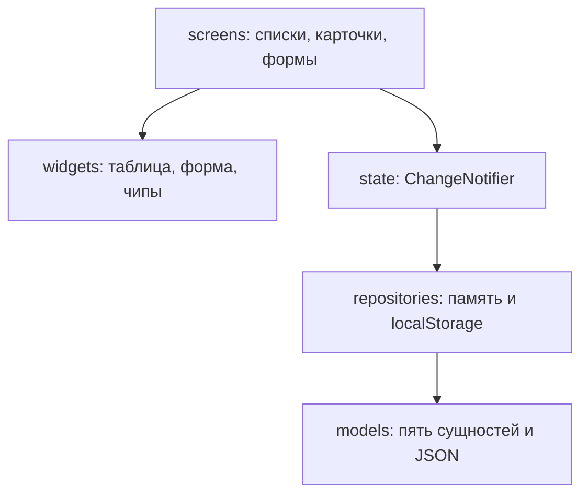

# Библиотека: формы, проверка и связи

Веб-каталог на Flutter. Пять сущностей: книги, авторы, жанры, издательства и читатели. Читательский билет редактируется внутри карточки читателя, отдельного списка у него нет. Записи лежат в `localStorage` браузера (`shared_preferences`) и переживают обновление страницы. Поиск, фильтры, сортировка, страницы и логическое удаление работают у всех пяти списков.

## Запуск

Это веб-приложение: в проекте подключена только платформа `web`, отдельного окна Windows нет. Нужны Flutter 3.50 (Dart 3.14, пакеты `material_ui` и `go_router` 17.5) и Google Chrome.

В PowerShell откройте каталог проекта и выполните:

```powershell
flutter pub get
flutter run -d chrome --web-port=5555
```

Первая сборка занимает одну-две минуты. После неё Chrome откроет http://localhost:5555/ . Остановить сервер: в том же терминале нажать `q`.

Если Chrome не находится, список устройств показывает `flutter devices` — id из списка подставляется в `-d`.

Проверки без браузера:

```powershell
flutter analyze
flutter test
```

Адрес без решётки включает `usePathUrlStrategy()`.

## Экраны

| Адрес | Что открывается |
| --- | --- |
| `/` | Главная |
| `/books` | Список книг |
| `/books/new` | Форма новой книги |
| `/books/1` | Карточка книги |
| `/books/1/edit` | Та же форма в режиме правки |
| `/authors`, `/genres`, `/publishers`, `/readers` | Списки. У каждого есть `/new`, `/:id` и `/:id/edit` |
| любой другой путь | 404 |

Условия списка, которые отличаются от значений по умолчанию, попадают в query-параметры: `search`, для книг ещё `genreId`, `publisherId`, `yearFrom`, `yearTo`, плюс `sort` (`поле,asc` или `поле,desc`), `page`, `size` (10, 25 или 50), `includeDeleted=1`. Кнопка «Назад» в браузере возвращает предыдущий набор, потому что каждое изменение списка уходит через `context.go`. Формы открываются через `context.push`, чтобы «Назад» вернуло к списку или карточке.

Поиск не дергает выборку на каждый символ: поле ждёт 300 мс после последнего ввода. Смена фильтра сбрасывает номер страницы на 1 и снимает выделение.

Ошибка загрузки для снимка экрана открывается адресом `/books?fail=1` (так же для `/authors`, `/genres`, `/publishers`, `/readers`). Пустой результат — это другой экран: например `/books?search=нет-такой-книги`.

Проверка полей живёт в `lib/validation/validators.dart`. Ошибка пишется под своим полем. Повтор ISBN и почты тоже возвращает валидатор поля. Удаление издательства, на которое ссылаются книги, не выполняется: диалог сообщает число связанных книг. На форме книги выбор издательства сужает город до его города, а выбор города сужает список издательств. Уход с несохранённой формы спрашивает подтверждение.

Ключи хранилища имеют суффикс `_v1`. Если в браузере осталась другая версия схемы или старые ключи без суффикса, каталог заменяется начальным набором и на экране появляется сообщение. Повреждённый JSON одной коллекции сбрасывает только её.

## Слои



Виджет списка читает нотификатор через `context.watch`. Форма после проверки пишет в репозиторий и заново загружает список. В `main` репозитории открываются из `shared_preferences`. Виджет-тесты по-прежнему собирают `LibraryApp()` без хранилища: тогда подставляются репозитории в памяти.

Жанр и издательство — отдельные списки. Город издательства нужен каскаду на форме книги. Поля книги и автора оставлены как в предыдущей работе: файла `api/КОНТРАКТ-API.md` в рабочей папке не было.

## Почему таблица одна

`EntityTable<T>` получает список, функцию идентификатора и описание колонок `TableColumnSpec<T>`. Книги и авторы подставляют разные колонки, но не копируют разметку `DataTable`, флажки, стрелку сортировки и двумерную прокрутку. Карточки на ширине окна меньше 600 пикселей собраны так же: один `EntityCardList<T>`, разный текст.

К итоговому проекту с жанрами, издательствами, читателями и выдачами отдельная таблица на каждую сущность раздула бы шесть почти одинаковых экранов. Обобщённый виджет оставляет отличия только в данных.

## Ошибка в deleteMany

В методичке цикл был таким:

```dart
final i = _books.indexWhere((b) => b.id == id && !b[i].isDeleted);
```

Код не компилируется. Внутри замыкания `b` — это `Book`, а не список, оператора `[]` у книги нет. Переменная `i` — результат `indexWhere`, её ещё нет, пока замыкание выполняется. Анализатор указывает на обращение по индексу.

Смысл условия другой: массовое удаление логическое, уже скрытые записи трогать не нужно. Рабочий вариант — `book.id == id && !book.isDeleted`. Метод возвращает число записей, которым только что проставлен `deletedAt`. Физическое удаление живёт отдельно и стирает объект из списка.

## Снимки для отчёта

Каталог `docs/screenshots`:

- `books-table.png` — список книг таблицей;
- `books-cards.png` — то же узким окном, карточками;
- `books-filters.png` — поиск, жанр и сортировка;
- `books-filters-url.png` — адресная строка с параметрами отбора;
- `books-selected.png` — несколько отмеченных строк и счётчик;
- `books-empty.png` — пустой результат;
- `books-error.png` — состояние ошибки.
