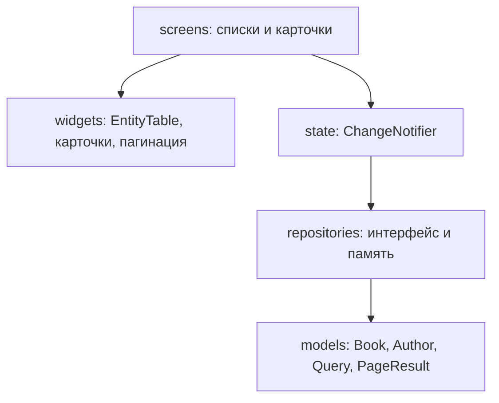

# Библиотека: списки, поиск и пагинация

Веб-каталог на Flutter. В этой работе два списка — книги и авторы. Данные лежат в памяти и после перезагрузки страницы снова берутся из начального набора. Сервер подключается позже.

## Запуск

Это веб-приложение: в проекте подключена только платформа `web`, отдельного окна Windows нет. Нужны Flutter 3.50 (Dart 3.14, пакеты `material_ui` и `go_router` 17.5) и Google Chrome.

В PowerShell откройте каталог проекта и выполните:

```powershell
flutter pub get
flutter run -d chrome --web-port=5555
```

Первая сборка занимает одну-две минуты. После неё Chrome откроет http://localhost:5555/ . Остановить сервер: в том же терминале нажать `q`.

Если Chrome не находится, список устройств показывает `flutter devices` — id из списка подставляется в `-d`.

Проверки без браузера:

```powershell
flutter analyze
flutter test
```

Адрес без решётки включает `usePathUrlStrategy()`.

## Экраны

| Адрес | Что открывается |
| --- | --- |
| `/` | Главная |
| `/books` | Список книг |
| `/books?search=война&genreId=2&sort=year,desc&page=3` | Тот же список с условиями из адреса |
| `/books/1` | Карточка книги |
| `/authors` | Список авторов |
| `/authors?search=сша&sort=country,desc` | Авторы с поиском и сортировкой |
| `/authors/1` | Карточка автора |
| любой другой путь | 404 |

Условия, которые отличаются от значений по умолчанию, попадают в query-параметры: `search`, `genreId`, `publisherId`, `yearFrom`, `yearTo`, `sort` (`поле,asc` или `поле,desc`), `page`, `size` (10, 25 или 50), `includeDeleted=1`. Кнопка «Назад» в браузере возвращает предыдущий набор, потому что каждое изменение уходит через `context.go`.

Поиск не дергает выборку на каждый символ: поле ждёт 300 мс после последнего ввода. Смена фильтра сбрасывает номер страницы на 1 и снимает выделение.

Ошибка загрузки для снимка экрана открывается адресом `/books?fail=1` или `/authors?fail=1`. Пустой результат — это другой экран: например `/books?search=нет-такой-книги`.

## Слои



Виджет не вызывает репозиторий. Экран читает `BookListNotifier` или `AuthorListNotifier` через `context.watch`. Нотификатор один раз описывает загрузку, страницу, ошибку и выделенные строки. Репозиторий в `main` подставлен как `InMemoryBookRepository`: в ПР4 его можно заменить, не переписывая экраны.

Жанры и издательства в этой работе — справочники для фильтра книг (`lib/data/seed.dart`). Отдельных экранов у них нет: задание просит сущности Book и Author. Поля книги взяты из методички. Поля автора — фамилия, имя, отчество, страна и год рождения: поиск по заданию идёт по фамилии и стране. Файла `api/КОНТРАКТ-API.md` в рабочей папке не было.

## Почему таблица одна

`EntityTable<T>` получает список, функцию идентификатора и описание колонок `TableColumnSpec<T>`. Книги и авторы подставляют разные колонки, но не копируют разметку `DataTable`, флажки, стрелку сортировки и двумерную прокрутку. Карточки на ширине окна меньше 600 пикселей собраны так же: один `EntityCardList<T>`, разный текст.

К итоговому проекту с жанрами, издательствами, читателями и выдачами отдельная таблица на каждую сущность раздула бы шесть почти одинаковых экранов. Обобщённый виджет оставляет отличия только в данных.

## Ошибка в deleteMany

В методичке цикл был таким:

```dart
final i = _books.indexWhere((b) => b.id == id && !b[i].isDeleted);
```

Код не компилируется. Внутри замыкания `b` — это `Book`, а не список, оператора `[]` у книги нет. Переменная `i` — результат `indexWhere`, её ещё нет, пока замыкание выполняется. Анализатор указывает на обращение по индексу.

Смысл условия другой: массовое удаление логическое, уже скрытые записи трогать не нужно. Рабочий вариант — `book.id == id && !book.isDeleted`. Метод возвращает число записей, которым только что проставлен `deletedAt`. Физическое удаление живёт отдельно и стирает объект из списка.

## Снимки для отчёта

Каталог `docs/screenshots`:

- `books-table.png` — список книг таблицей;
- `books-cards.png` — то же узким окном, карточками;
- `books-filters.png` — поиск, жанр и сортировка;
- `books-filters-url.png` — адресная строка с параметрами отбора;
- `books-selected.png` — несколько отмеченных строк и счётчик;
- `books-empty.png` — пустой результат;
- `books-error.png` — состояние ошибки.
